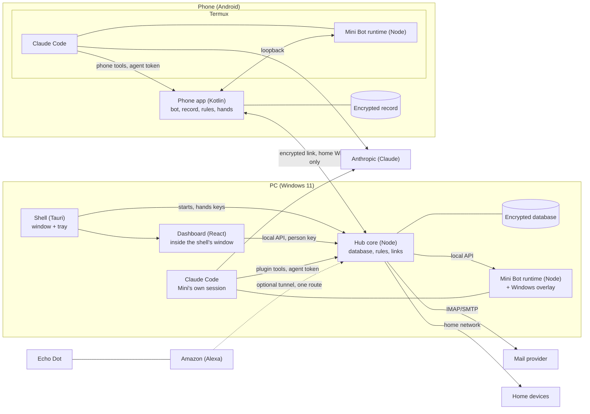

# 01. Architecture

## The picture

## The parts

| Part | Runs on | Language | Job |
|---|---|---|---|
| **Shell** | PC | Rust (Tauri 2) | Tray icon, dashboard window, global key, start with Windows. Fetches the database key from Windows Credential Manager, makes the person key, starts the core and hands both over. Tiny on purpose. |
| **Dashboard** | PC, inside the shell's window | TypeScript, React | Everything the owner sees and clicks. Talks only to the core. |
| **Core** | PC, background | TypeScript on Node | The database, grants, approvals, the audit log, connectors, the link to paired devices, the local API. Keeps running when the window is closed. |
| **Mini Bot runtime + overlay** | PC | Node + C# | Exists already. The floating bot, voice, computer control, its own permission cards. The hub reads its state and sends it prompts; it does not replace it. |
| **Mini's Claude Code session** | PC | n/a | Exists already. The brain. Gains a few `hub_*` tools through the Mini Bot plugin. |
| **Phone app** | Phone | Kotlin | The floating bot, the phone's record, the phone's own grants and approvals, the hands (reading and controlling the phone), the link to the hub, voice. |
| **Mini Bot runtime in Termux** | Phone | Node | The same runtime code as on the PC, used on the phone for the plumbing only: keeping the Claude Code session, queueing prompts, passing replies back. |
| **Claude Code in Termux** | Phone | n/a | The brain on the phone, with the Mini Bot plugin. |
| **Connectors** | Inside the core | TypeScript | One per kind of device or account: `pc`, `mini`, `android`, `mail`, `home`, `alexa`. |

## Why the phone is split the way it is

On the phone, everything in Termux (Claude Code, the runtime, their files) is one Android sandbox, and Claude
Code can run commands there. So nothing in Termux can be trusted to hold a permission: Mini could, in principle,
edit it. The Android app is a different sandbox that Termux cannot reach. Therefore:

- **the phone app owns the rules** for everything on the phone: what is recorded, what Mini may read, what Mini
  may do, and every approval;
- **Termux holds only the brain and its plumbing**; it asks the phone app for everything through a small tool
  interface, and the phone app checks each request against its own grants.

This is the same idea as on the PC, where the owner's click in the bot (not a file Claude could write) is what
turns access on, and it is stricter, because Android enforces the wall.

## Processes and addresses on the PC

| Process | Listens on | Who may call it | How they prove it |
|---|---|---|---|
| Core, local API | `127.0.0.1`, a free port chosen at start | The dashboard; Mini's plugin tools | Dashboard: the person key (in memory only). Tools: the agent token (in `hub.json`). |
| Core, device link | The PC's home-network address, port `47800`, TLS | Paired devices | The device's own token, over a certificate the device pinned when it was paired |
| Core, Alexa route | `127.0.0.1`, its own port, **off unless the Alexa connector is on** | Amazon, through the tunnel | Amazon's request signature, the skill's id, and a fresh timestamp |
| Mini Bot runtime | `127.0.0.1`, its own port | The Mini Bot plugin, its overlay, the hub core | Its own token and overlay key, as today |

- The core's data folder is `%APPDATA%\MiniHub` (`MINI_HUB_HOME` overrides it, for tests). It holds the database,
  the hub's certificate, and `hub.json` (`port`, `token`, `pid`, `version`), which is how the Mini Bot plugin finds the core.
- The device link listens only while at least one device is paired or a pairing is in progress, and only on
  addresses that belong to a network Windows marks as private.
- Nothing listens on a public address. The Alexa route is reached only through an outgoing tunnel that the
  owner starts by turning that connector on.

## How the main things happen

### 1. Something happens on the phone

1. The phone app's collector sees it (a call ends, an SMS or a notification arrives) and, if collecting that kind
   of thing is switched on, writes one **event** to the phone's own encrypted record, with the next sequence number.
2. If the phone is linked to the hub right now, the event goes over the link at once. If not, it waits.
3. When the link comes up (the PC is on and both are on the home network), the phone sends everything after the
   last sequence number the hub confirmed, in order, in batches. The hub stores each batch and confirms it.
4. The dashboard updates live.

The record only ever moves when the phone sends it: the PC cannot pull history the phone has not handed over,
and it learns nothing while it is off. Live commands (ring, read the screen now) are a separate thing, run only
while linked, and need the phone's own "From my PC" switch for that kind of action (`03`).

### 2. The owner asks Mini on the PC about their phone

1. "Who called me this morning?" goes to Mini's Claude Code session as today.
2. Claude calls the `hub_read` tool. The Mini Bot plugin serves it by calling the core with the agent token.
3. The core checks the grant for that kind of data (`phone.calls.read`). **Off**: the answer is "not allowed", and
   Mini says so. **Ask**: an approval appears in the dashboard (the bot says one is waiting), and the call waits for the owner.
   **On**: the data is returned.
4. Either way, the core writes an audit entry: who asked, for what, what was decided.

### 3. Mini acts on something

1. Claude calls `hub_act` (for example: switch the bedroom lamp on, answer a message, ring the phone).
2. The core finds the action's scope and its risk. Risk `important` always asks, whatever the grant says.
3. If an approval is needed, it shows in the dashboard, and the bot says an answer is waiting there. Only the
   person key (the dashboard) or, for an action on the phone, the phone app's own screen can answer it.
4. The connector carries the action out. The result and the approval are logged.
5. For an action on the phone, the command then goes over the link, and the phone app checks its own "From my
   PC" switch for that kind of action: **off** refuses, **ask** puts the question on the phone's screen as well,
   **on** runs it. While it runs, the phone shows that it is being controlled.

### 4. Mini on the phone, with the PC off

1. The owner taps the bot (or the tile, or the assistant gesture) and speaks or types.
2. The phone app turns speech into text on the phone and puts the prompt in the runtime's queue in Termux.
3. Claude Code in Termux picks it up through the Mini Bot plugin, as on the PC.
4. When Claude needs the phone ("read my last messages", "open the camera"), it calls a `phone_*` tool. The plugin
   passes it to the phone app, which checks its own grants, asks the owner if needed, acts, and logs it.
5. The reply comes back through the runtime to the phone app, which shows it in the bot's panel and can say it aloud.
6. Everything Mini did is written to the phone's record as events, and reaches the hub at the next sync.

### 5. The PC comes back on

1. The core starts with Windows, in the background.
2. The phone app notices the hub on the home network (it looks for it when the network changes and every few
   minutes while at home) and connects.
3. Flow 1, step 3: the backlog is handed over. The dashboard shows a "catching up" bar until it is done.

### 6. Talking to Mini through the Echo Dot (optional)

1. "Alexa, ask Mini ..." goes from the Echo Dot to Amazon, which calls the skill's address.
2. That address is a tunnel that ends at the core's Alexa route. The core checks Amazon's signature.
3. The core sends the words to Mini's session on the PC as a prompt marked as coming from voice in the room.
4. If the answer is ready within about 6 seconds, Alexa says it. If not, Alexa says Mini is working on it, and
   the answer waits: "Alexa, ask Mini what it found."
5. Voice in the room is the least trusted way in: anyone can speak. It can ask and can run only what the owner
   marked as safe by voice. It can never approve anything. These limits are enforced in code for the whole of that
   turn, by the core and by the Mini Bot plugin, not by the wording of the prompt (`03`, `09`).

## What works when

| Situation | Dashboard | Mini on the PC | Mini on the phone | Phone record | Alexa voice |
|---|---|---|---|---|---|
| PC on, phone at home | Live | Yes | Yes | Syncing live | Yes, if turned on |
| PC on, phone away | Shows everything up to the last sync | Yes | Yes | Kept on the phone | Yes, if turned on |
| PC off | n/a | No | Yes | Kept on the phone | No |
| No internet | Works on what it has | No (Claude is unreachable) | No | Still recorded | No |
| Claude Code on the phone broken by an update | Unaffected | Unaffected | No. The app says so and keeps recording. | Still recorded | Unaffected |

## What can go wrong, and what the design does about it

| Problem | Handling |
|---|---|
| The link drops in the middle of a sync | Batches are confirmed one by one and keyed by device and sequence number, so sending again stores nothing twice |
| The phone's clock and the PC's clock differ | Every event carries the time it happened on the phone and the time the hub received it. The dashboard orders by the first. |
| The phone was offline for weeks | The phone keeps events until they are confirmed, up to a size limit (default 200 MB), then drops the oldest and records that it did |
| An action was asked for while the phone was offline | It fails at once with "the phone is not connected". Actions are never queued for later: a late action is a wrong action. |
| Android stops the phone app or Termux | The app runs a foreground service and restarts the brain when it notices it is gone. The bot shows "asleep" until it is back. |
| The hub's database key is lost (Windows reinstalled) | The database cannot be opened. The owner restores from a backup they made with the export in Settings, or starts fresh and pairs again. The phone still has what it had not handed over. |
| A device is lost or stolen | The owner removes it in the dashboard. Its token stops working at once. |
| The core is not running when Mini calls a `hub_*` tool | The tool answers "the hub is not running" and Mini says so |
